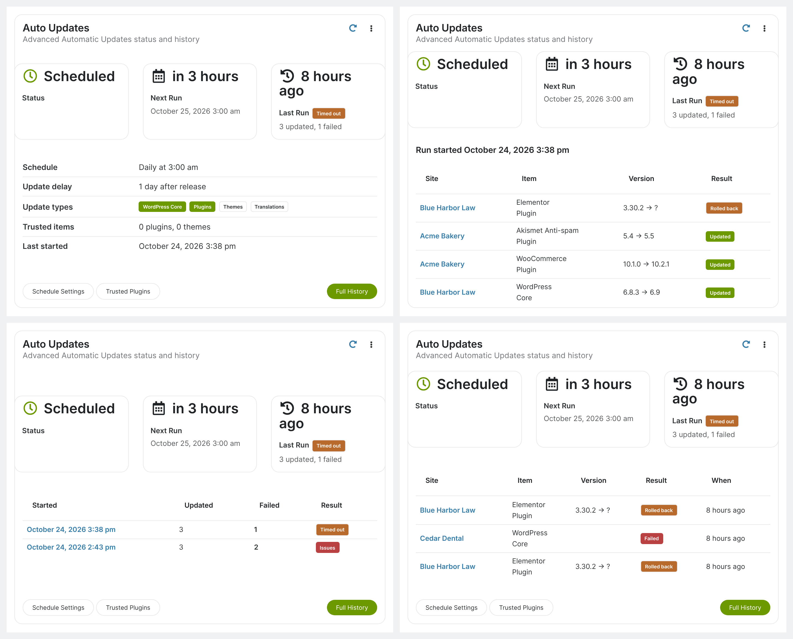

# Auto Updates Status for MainWP

By [ProAdmin](https://proadmin.com)

A MainWP Dashboard extension that adds an **Auto Updates** widget to the Operations page. It shows the status, schedule, live progress and run history of MainWP's built-in Advanced Automatic Updates.

## Features

- **Status:** scheduled, running (with live progress), overdue or disabled. Also shows the next run, the last run's result, the schedule, update delay, enabled update types and trusted item counts.
- **Latest Run:** every update in the most recent run, with old and new versions and a result of updated, failed or rolled back (hover to see the error).
- **Run History:** the last 10 runs, plus a full, paginated history page with per-run details.
- **Recent Failures:** failed and rolled-back updates from all runs.
- History retention setting, 90 days by default.

## Requirements

- MainWP Dashboard (tested with 6.3)
- WordPress 6.2+
- PHP 7.4+

## Installation

1. Download a release zip, or build one with `bin/build-zip.sh`.
2. In the Dashboard site's WordPress admin, go to **Plugins → Add New Plugin → Upload Plugin**, upload the zip and activate it.
3. Open **MainWP → Operations**. If the widget is hidden, turn on **Auto Updates Status** in Page Settings (the cog icon).

See the [installation guide](docs/installation-guide.pdf) and the [user guide](docs/user-guide.pdf) for full details.

## Upgrading from 1.0.x

Version 1.1.0 renamed the plugin folder from `mainwp-auto-updates-status` to `auto-updates-status-for-mainwp`. To keep your history, deactivate the old plugin and remove its folder by FTP or your host's file manager. Don't use **Delete** on the Plugins page, because that runs the uninstaller and erases the history. Then install and activate 1.1.0. It picks up the existing tables and settings.

## Building the zip

Run `bin/build-zip.sh` to create `dist/auto-updates-status-for-mainwp.zip`. The zip contains the plugin, `LICENSE.txt` and both guides (in `docs/`).

## How it works

MainWP keeps only the latest run's results (in the `mainwp_updates_report_storage` option) and clears them when the next run starts. The extension watches that option, and `mainwp_automatic_updates_is_running`, and copies each result into its own tables (`{prefix}mainwp_aus_runs` and `{prefix}mainwp_aus_items`) as soon as MainWP saves it. MainWP itself isn't modified. History builds up from the day the extension is activated.

## Known limitations

- Live progress and each run's site count use the same per-site start time that MainWP's batch updates use. If a batch update is started during an automatic run, the progress bar drops and that run's site count is too low. The widget can also show **Overdue** while a batch update holds MainWP's cron.
- On WordPress multisite, activation and uninstall only act on the current site.
- If the extension isn't loaded when MainWP finishes a run (for example, it was deactivated during the run), the run is closed the next time the widget or history page is viewed, without an end time or duration.

## Hooks

| Hook | Type | Purpose |
| --- | --- | --- |
| `mainwp_aus_capability` | filter (string) | WordPress capability required to see the widget and history (default `manage_options`) |
| `mainwp_aus_can_view` | filter (bool) | Final yes/no on who can see the widget and history |
| `mainwp_aus_refresh_interval` | filter (int seconds, 0 disables) | Live refresh while a run is in progress |
| `mainwp_aus_widget_title` | filter (string) | Widget title |
| `mainwp_aus_run_finished` | action (`$run_start`, `$status`) | Fires when a run is recorded as finished |

## License

Copyright (c) 2026 [ProAdmin](https://proadmin.com).

Released under the GNU General Public License v2 or later. See [LICENSE.txt](LICENSE.txt).
